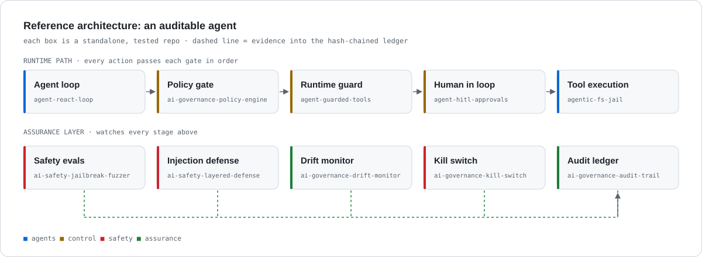

<picture>
  <source media="(prefers-color-scheme: dark)" srcset="assets/hero-dark.svg">
  
</picture>

<br>

[](https://www.linkedin.com/in/ramkumar-bharathan-vicepresidenttechnologybusinessprocessauditinnovation)
[](https://www.chicagobooth.edu/why-booth/stories/from-a-small-village-to-an-executive-mba)
[](https://github.com/ramtoo-cell/controltrace)
[](https://github.com/ramtoo-cell/anthropic-fellowships-2027)
[](https://github.com/ramtoo-cell/frontier-reasoning-bench)
[](https://github.com/ramtoo-cell/agentgate)

I build **verifiable evaluation harnesses for judgment-heavy AI reasoning** and **zero-trust runtime infrastructure for autonomous agents**. 

Where code and math have compilers, the hardest real-world decisions—across **policy, law, audit judgment, economics, cognitive science, and philosophy**—have no single checkable answer key. Models routinely sound persuasive while treating uncorroborated allegations as proof, violating game-theoretic equilibria, or conflating empirical facts with normative obligations. With nearly two decades of practicing codified evidentiary judgment across Fortune-10 technology audits (16 years at PwC across India, Dubai, and the US serving Google, Meta, Microsoft, and Amazon; writing internal audit and IT SOX playbooks for Google and Microsoft; working on the Waymo and Tesla external audits; and now leading cloud, cyber, and AI audits at a Fortune-10 global financial institution), I build benchmarks and RL environments that test whether AI agents reach conclusions on **sufficient, appropriate evidence** rather than surface salience.

**Core Thesis:** *Auditors learn early that the most dangerous error is not the wrong conclusion, but the right one reached for the wrong reasons. It passes review, and it fails precisely when the facts shift.*

---

## 🧠 1. Conceptual Reasoning Evals & Evidentiary Faithfulness

A complete, zero-dependency evaluation stack for testing whether frontier models (**Claude, Gemini, o-series**) separate allegation from proof and reason faithfully through domain constraints:

### [`controltrace`](https://github.com/ramtoo-cell/controltrace) &nbsp;[](https://github.com/ramtoo-cell/controltrace) [](https://github.com/ramtoo-cell/controltrace)
**Teaching AI agents the difference between allegation and proof — evaluating professional skepticism and calibrated escalation:**
- **External Normative Anchor:** Ground truth is anchored in codified audit-evidence standards (**PCAOB AS 1105**, **ISA 500**): independent confirmations and cryptographic telemetry outrank internal management assertions, and an uncorroborated complaint is not proof.
- **Three-Axis Separation:** Scores **(1) Conclusion Accuracy**, **(2) Evidence Faithfulness** (whether the agent cites excluded red herrings or unsubstantiated allegations), and **(3) Escalation Calibration** (`resolve` vs. `escalate`, plus minimal pairs that flip on a single piece of corroborating evidence).
- **Pilot Finding (6 cases, blind Claude baseline, 1 sample/case):** Reached the right outcome in **5 of 6** cases, yet cited evidence that should have been excluded in **5 of 6** cases—and in **1 of 6** (`CT-001`) correctly computed that a vendor's disclosure had lapsed >3 years earlier, then treated an unsubstantiated competitor complaint as proof of a violation and escalated it. *(Explicit [Limitations section](https://github.com/ramtoo-cell/controltrace#limitations-stated-plainly) documented in repo; held-out ground truth kept private via SHA-256 commitments.)*

```bash
git clone https://github.com/ramtoo-cell/controltrace && cd controltrace && PYTHONPATH=src python3 -m controltrace.cli
```

### [`frontier-reasoning-bench`](https://github.com/ramtoo-cell/frontier-reasoning-bench) &nbsp;[](https://github.com/ramtoo-cell/frontier-reasoning-bench) [](https://github.com/ramtoo-cell/frontier-reasoning-bench/blob/main/docs/DESIGN.md)
**Step-level invariant verification & process-supervision reward oracles across all 5 conceptual disciplines:**
- **Economics (`Mechanism_Design`):** Enforces the **Myerson-Satterthwaite Impossibility Theorem** (flagging mechanisms claiming ex-post efficiency + BIC + IIR + budget balance without outside subsidy) and Vickrey dominant-strategy truthfulness ($b_i = v_i$).
- **Philosophy (`Deontic_Modal_Logic`):** Verifies **Standard Deontic Logic ($\mathbf{SDL}$ / $\text{KD45}_n$)** Axiom D consistency ($\neg(\mathcal{O}p \wedge \mathcal{F}p)$), Hume's Guillotine (no $\mathcal{O}p \leftrightarrow p$ deontic collapse), and dyadic resolution of **Chisholm's Contrary-to-Duty (CTD)** paradox.
- **Cognitive Science (`Cognitive_Science`):** Audits exact Bayesian posterior updating under low-prevalence priors, catching **Base-Rate Neglect** and **Tversky-Kahneman Conjunction Fallacies** ($P(A \wedge B) > P(A)$).
- **Policy & Governance (`Policy_Governance`):** Separates **Strict Pareto Dominance**, **Kaldor-Hicks potential compensation**, and **Rawlsian Maximin** welfare floors across multi-stakeholder allocations.
- **Law & Jurisprudence (`Law_Jurisprudence`):** Verifies formal canons of statutory construction (***Lex Specialis Derogat Legi Generali*** safe-harbor precedence and ***Ejusdem Generis*** enumerated class bounds).

```bash
git clone https://github.com/ramtoo-cell/frontier-reasoning-bench && cd frontier-reasoning-bench && python3 -m bench.cli --track ALL
```

### [`policy-reasoning-bench`](https://github.com/ramtoo-cell/policy-reasoning-bench) &nbsp;[](https://github.com/ramtoo-cell/policy-reasoning-bench)
**72 hand-built evaluation cases** across **Philosophy (24)**, **Economics (24)**, and **Law & Policy (24)**.
- Every case includes a novel scenario prompt, worked gold derivation, weighted 3-part grading rubric, underlying theoretical principle, and an explicit note on why the task tests *application* rather than *memorization*.

### [`reasoning-eval-harness`](https://github.com/ramtoo-cell/reasoning-eval-harness) &nbsp;[](https://github.com/ramtoo-cell/reasoning-eval-harness)
**Standalone evaluation harness for accuracy, epistemic calibration, and failure-mode clustering:**
- Measures **Expected Calibration Error (ECE)** and Brier scores alongside rubric accuracy—distinguishing calibrated uncertainty from overconfident hallucination.

### [`reasoning-paired-evals`](https://github.com/ramtoo-cell/reasoning-paired-evals) · [`reasoning-calibration-audit`](https://github.com/ramtoo-cell/reasoning-calibration-audit) · [`reasoning-rubric-reliability`](https://github.com/ramtoo-cell/reasoning-rubric-reliability)
**Statistical & psychometric rigor for reasoning benchmarks:**
- **Paired Inference (`reasoning-paired-evals`):** Non-parametric paired bootstrap confidence intervals and exact binomial **McNemar discordance tests** on off-diagonal transitions ($b$ vs. $c$).
- **Abstention & Selective Prediction (`reasoning-calibration-audit`):** Risk-coverage curves and selective-abstention thresholds for determining when a reasoning system should abstain rather than answer overconfidently.
- **Inter-Rater Agreement (`reasoning-rubric-reliability`):** Psychometric reliability auditing across human/LLM judges to measure whether reviewers agree on the subjective judgments a benchmark depends on.

### [`anthropic-fellowships-2027`](https://github.com/ramtoo-cell/anthropic-fellowships-2027) &nbsp;[](https://github.com/ramtoo-cell/anthropic-fellowships-2027)
- Complete research agenda, [Statement of Purpose](https://github.com/ramtoo-cell/anthropic-fellowships-2027/blob/main/statements/CONCEPTUAL_REASONING_FELLOW_STATEMENT.md), and [5-Discipline Verification Report](https://github.com/ramtoo-cell/anthropic-fellowships-2027/blob/main/benchmarks/FRONTIER_REASONING_EVALS_REPORT.md).

---

## 🛡️ 2. Production Agentic Assurance & Zero-Trust MCP Infrastructure

<picture>
  <source media="(prefers-color-scheme: dark)" srcset="assets/arch-dark.svg">
  
</picture>

### [`agentgate`](https://github.com/ramtoo-cell/agentgate) &nbsp;[](https://github.com/ramtoo-cell/agentgate/actions/workflows/ci.yml) [](https://github.com/ramtoo-cell/agentgate/blob/main/docs/DESIGN.md)
**Policy, human approval, and a tamper-evident audit trail for every AI agent tool call.** Use as a Python decorator or as a drop-in **MCP proxy** in front of any MCP server (Claude Desktop, Cursor) with zero code changes.
- **Default-deny JSON policies:** Unauthorized tools are stripped from `tools/list` so the model never sees them.
- **Cryptographic audit ledger:** Append-only, SHA-256 hash-chained and optionally **HMAC-keyed** JSONL ledger. `agentgate verify` pinpoints the exact first tampered line.
- **Sub-100µs overhead:** **`~65 µs per call`** after profiling-driven optimization (4× faster than v0.1). Zero dependencies, 60 tests, 95% coverage, CI on Python 3.9–3.13.
- Includes a Google-style **[Design Doc & Threat Model (`docs/DESIGN.md`)](https://github.com/ramtoo-cell/agentgate/blob/main/docs/DESIGN.md)**.

```bash
pip install git+https://github.com/ramtoo-cell/agentgate
```

### [`agent-guardian`](https://github.com/ramtoo-cell/agent-guardian) &nbsp;[](https://github.com/ramtoo-cell/agent-guardian)
**Governance sidecar for autonomous AI agents.**
- Wraps any agent callable with policy enforcement (blocklists, PII redaction, prompt-injection defense), hard execution budgets (steps, tokens, cost, wall-clock latency), hash-chained audit logs, and built-in red-team & conceptual reasoning evals.

```bash
pip install git+https://github.com/ramtoo-cell/agent-guardian
```

---

## 📦 3. Modular Primitives by Layer (360+ Public Repositories)

Every repository is a small, sharp, self-contained primitive: zero external dependencies, deterministic `unittest` suite, and single-concern design. **[Browse the full catalog →](https://github.com/ramtoo-cell/ai-portfolio-index)**

<table>
<tr>
<td width="33%" valign="top">

**🛡️ AI Safety, Evals & Alignment**<br>
<sub>100+ repos</sub>

Red-teaming, interpretability, unlearning, watermarking, calibration.

- [controltrace](https://github.com/ramtoo-cell/controltrace)
- [frontier-reasoning-bench](https://github.com/ramtoo-cell/frontier-reasoning-bench)
- [policy-reasoning-bench](https://github.com/ramtoo-cell/policy-reasoning-bench)
- [reasoning-eval-harness](https://github.com/ramtoo-cell/reasoning-eval-harness)
- [reasoning-paired-evals](https://github.com/ramtoo-cell/reasoning-paired-evals)
- [ai-safety-jailbreak-fuzzer](https://github.com/ramtoo-cell/ai-safety-jailbreak-fuzzer)
- [ai-safety-tripwire-eval](https://github.com/ramtoo-cell/ai-safety-tripwire-eval)
- [ai-safety-circuit-graph](https://github.com/ramtoo-cell/ai-safety-circuit-graph)
- [ai-safety-sycophancy-eval](https://github.com/ramtoo-cell/ai-safety-sycophancy-eval)

</td>
<td width="33%" valign="top">

**⚖️ AI Governance & Policy-as-Code**<br>
<sub>60+ repos</sub>

Controls, evidence pipelines, statutory mapping, incident response.

- [agentgate](https://github.com/ramtoo-cell/agentgate)
- [agent-guardian](https://github.com/ramtoo-cell/agent-guardian)
- [awesome-ai-governance](https://github.com/ramtoo-cell/awesome-ai-governance)
- [ai-governance-audit-trail](https://github.com/ramtoo-cell/ai-governance-audit-trail)
- [ai-governance-policy-engine](https://github.com/ramtoo-cell/ai-governance-policy-engine)
- [ai-governance-eu-ai-act-mapper](https://github.com/ramtoo-cell/ai-governance-eu-ai-act-mapper)
- [ai-governance-model-risk-register](https://github.com/ramtoo-cell/ai-governance-model-risk-register)
- [ai-governance-kill-switch](https://github.com/ramtoo-cell/ai-governance-kill-switch)

</td>
<td width="33%" valign="top">

**🤖 Agentic Systems & Verification**<br>
<sub>100+ repos</sub>

Agent loops, MCP servers, sandboxing, contract nets, trajectory replay.

- [agent-react-loop](https://github.com/ramtoo-cell/agent-react-loop)
- [agent-mcp-server](https://github.com/ramtoo-cell/agent-mcp-server)
- [agent-hitl-approvals](https://github.com/ramtoo-cell/agent-hitl-approvals)
- [agentic-fs-jail](https://github.com/ramtoo-cell/agentic-fs-jail)
- [agentic-contract-net](https://github.com/ramtoo-cell/agentic-contract-net)
- [agent-trajectory-replayer](https://github.com/ramtoo-cell/agent-trajectory-replayer)
- [govops-model-card-diff](https://github.com/ramtoo-cell/govops-model-card-diff)
- [govops-release-checklist](https://github.com/ramtoo-cell/govops-release-checklist)

</td>
</tr>
</table>

---

## 📐 Engineering & Research Principles

| Principle | In Practice |
| :--- | :--- |
| **Step-Level Process Verification** | Outcome accuracy masks flawed deduction. Evals verify intermediate domain invariants (Myerson-Satterthwaite, SDL Axiom D, Bayes coherence, *lex specialis*) at every step. |
| **Calibration Alongside Accuracy** | A model that knows when it doesn't know is safer than one that hallucinates with high confidence. Every harness reports ECE and paired discordance $p$-values. |
| **Evidence Over Assertion** | Every prompt, reasoning trace, policy decision, and tool call is hash-chained in an append-only ledger. If it wasn't cryptographically logged, it didn't happen. |
| **Default Deny & Capability Isolation** | Egress, filesystem paths, MCP tools, and token budgets start closed. Capabilities are granted one at a time, with explicit human-in-the-loop escalation. |
| **Zero-Dependency Reproducibility** | Pure Python 3 standard library first, deterministic unit tests, sub-millisecond execution, and explicit design docs with threat models. |

---

## 🎓 Background

- **Education:** **The University of Chicago Booth School of Business** — MBA (Honors) · **Purdue University** — M.S. in Artificial Intelligence *(in progress)* · Chartered Accountant (CA) · CISA *(in progress)*
- **Intellectual Property:** 2 USPTO AI patent applications pending · 4 published AI defensive disclosures
- **Experience:** 18+ years leading technology risk architecture, IT audit innovation, and governance engineering across Tier-0 global financial institutions and Big Four advisory (PwC)
- **Research Focus:** Conceptual reasoning evals (economics, law, policy, philosophy, cognitive science), process supervision, epistemic calibration, and zero-trust agentic governance

<br>

<sub>Building in public. If you work on frontier reasoning evaluations, scalable oversight, or agent assurance at Anthropic, Google DeepMind, or OpenAI, let's connect via <a href="https://www.linkedin.com/in/ramkumar-bharathan-vicepresidenttechnologybusinessprocessauditinnovation">LinkedIn</a> or open an issue on any repository.</sub>
